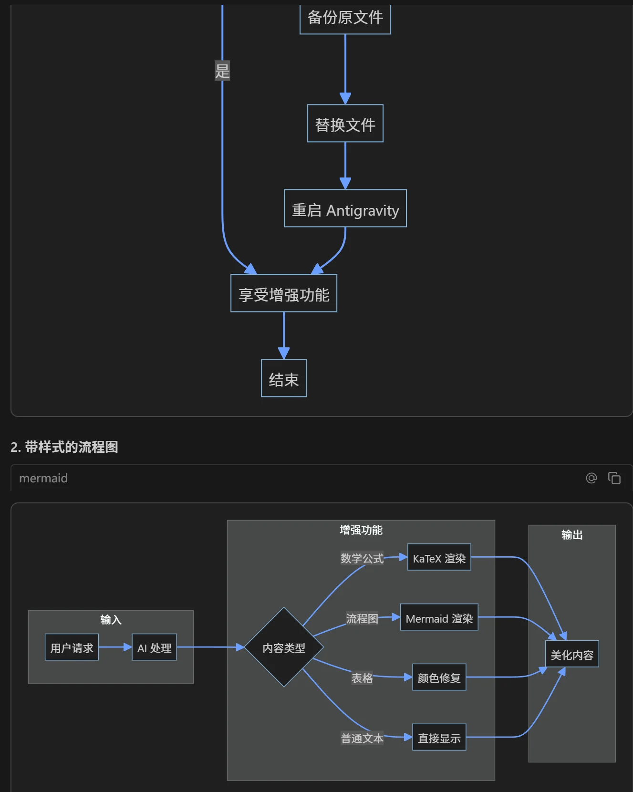
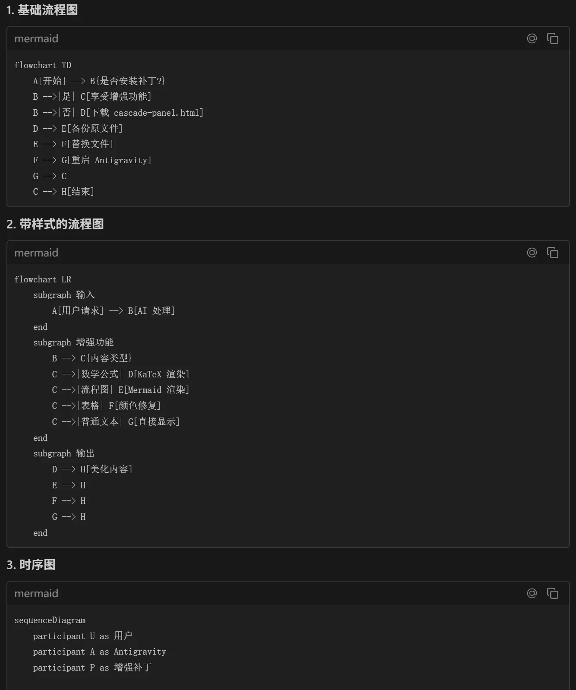
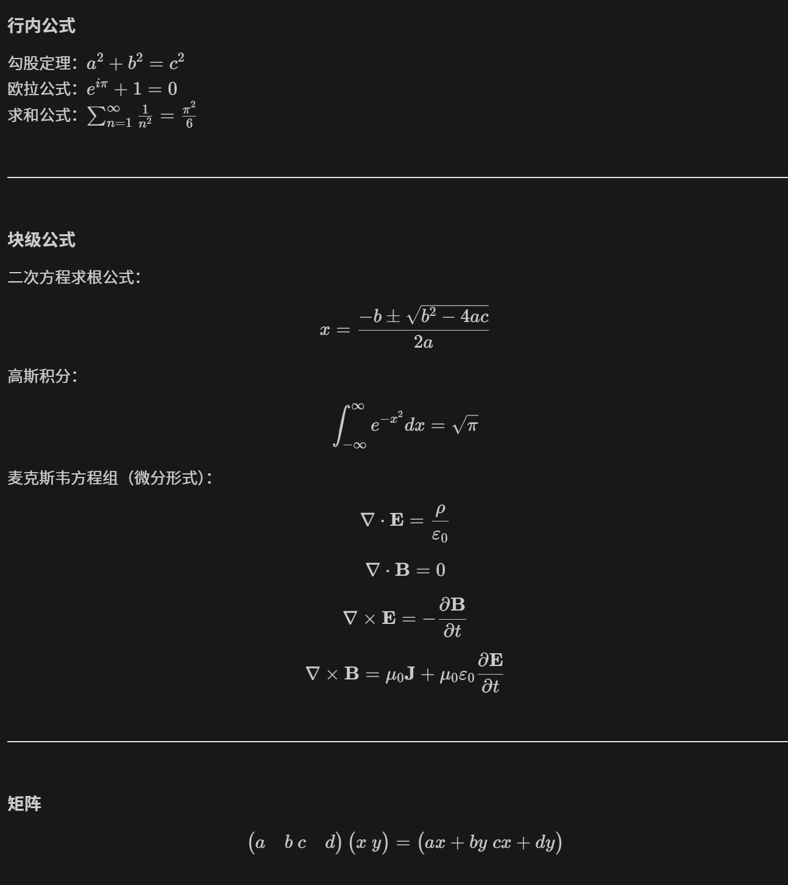
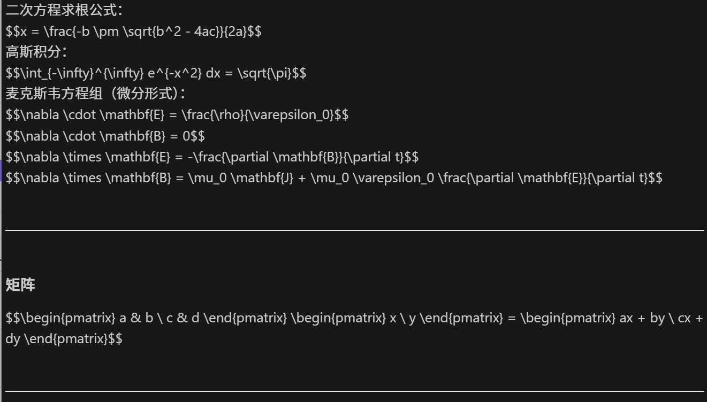
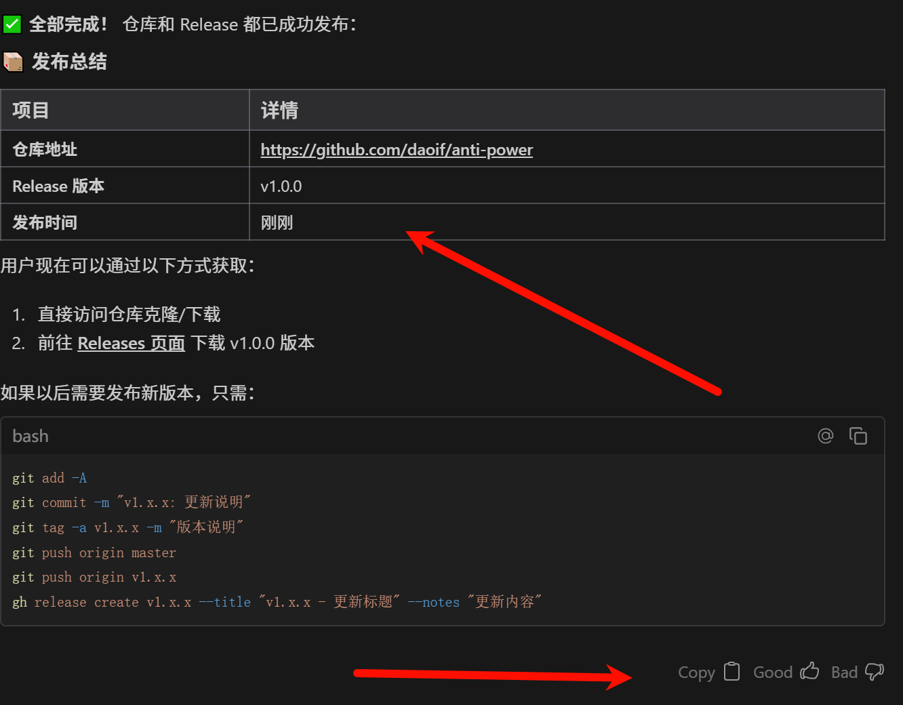
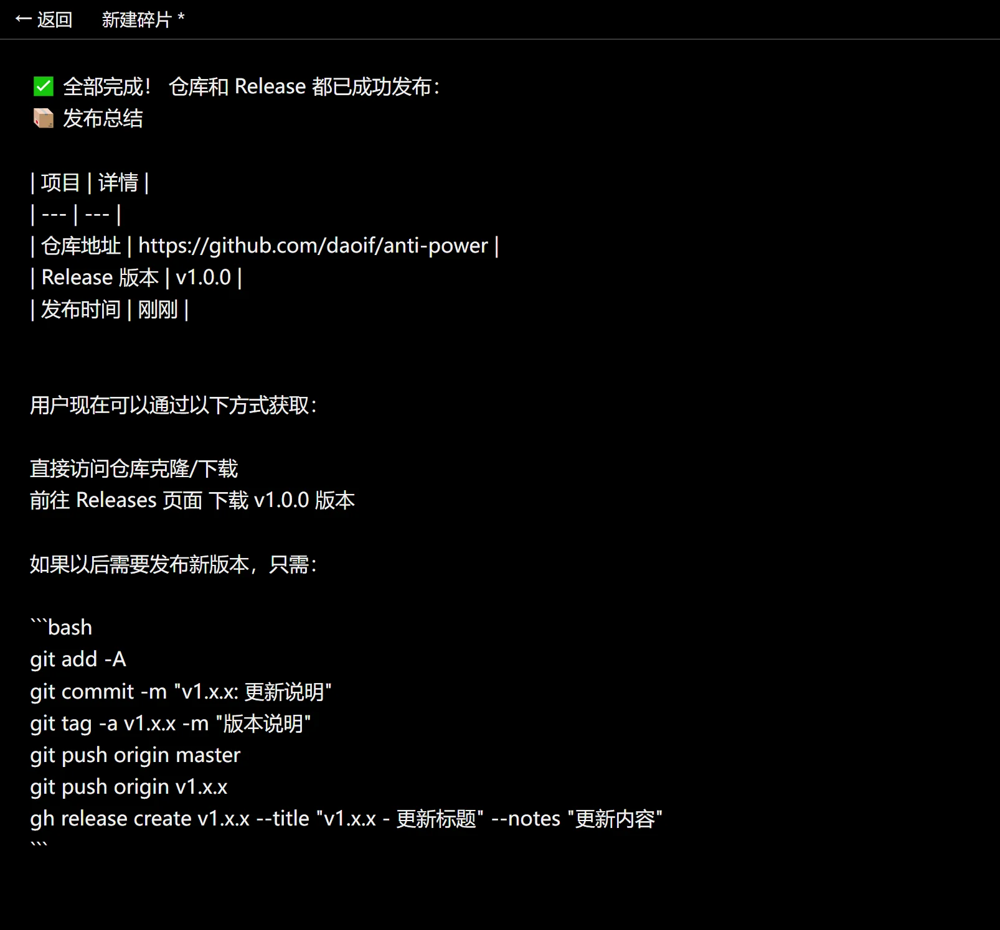

<p align="center">
  
</p>

<h1 align="center">Anti-Power 增强补丁</h1>

<p align="center">
  <a href="https://github.com/daoif/anti-power/releases">
    
  </a>
  <a href="https://codeium.com/antigravity">
    
  </a>
  <a href="LICENSE">
    
  </a>
</p>

> **Antigravity AI IDE** 对话界面补丁。

---

## ✨ 功能特性

| 功能 | 描述 |
|------|------|
| **Mermaid 渲染** | 自动渲染流程图、时序图和类图等，支持深色主题 |
| **数学公式渲染** | 支持 `$...$` 行内公式和 `$$...$$` 块级公式 |
| **一键复制** | 用 Copy 按钮将 AI 回复复制为 Markdown |
| **表格颜色修复** | 修复深色主题下表格文字不可见问题 |
| **悬浮复制按钮** | 鼠标悬停时在内容区右上角显示 |

### 复制功能

- 📝 代码块自动带语言标识（如 ` ```python `）
- 📊 自动将表格转为 Markdown
- 🧠 仅复制 AI 的最终回复，跳过中间思考过程
- 📎 公式和 Mermaid 自动还原为源码

---

## 📸 效果展示

### 🎨 Mermaid 流程图渲染

原版 Antigravity 显示 Mermaid 源码。安装补丁后，可直接渲染流程图。



<details>
<summary>👀 查看原版效果（点击展开）</summary>



</details>

---

### 📐 数学公式渲染

原版显示 LaTeX 源码。启用补丁后，公式会自动渲染。



<details>
<summary>👀 查看原版效果（点击展开）</summary>



</details>

---

### 📋 一键复制 & 表格优化

**Copy** 按钮可将 AI 回复复制为 Markdown。补丁也修复了表格颜色。



复制的 Markdown 可以直接粘贴到其他编辑器。



---


## 📥 下载安装

### 方式一：GitHub Releases（推荐）

前往 [Releases 页面](https://github.com/daoif/anti-power/releases) 下载最新版本。

### 方式二：直接下载文件

下载本仓库的 `cascade-panel.html` 文件。

---

## 🔧 安装步骤

### 步骤一：找到 Antigravity 安装目录

#### 📁 Windows

1. 在桌面上右键点击 **Antigravity** 快捷方式
2. 选择 **"属性 (Properties)"**
3. 点击 **"打开文件所在位置 (Open File Location)"**
4. 进入目录：`resources\app\extensions\antigravity\`

**完整路径示例：**
```
C:\Program Files\Antigravity\resources\app\extensions\antigravity\
```

<details>
<summary><b>📁 macOS</b></summary>

1. 打开 **"应用程序 (Applications)"** 文件夹
2. 右键点击 **Antigravity.app**
3. 选择 **"显示包内容 (Show Package Contents)"**
4. 进入目录：`Contents/Resources/app/extensions/antigravity/`

**完整路径：**
```
/Applications/Antigravity.app/Contents/Resources/app/extensions/antigravity/
```

</details>

### 步骤二：备份原文件（重要！）

将原始 `cascade-panel.html` 重命名为 `cascade-panel.html.bak`，或复制到其他位置备份。

### 步骤三：替换文件

将下载的 `cascade-panel.html` 复制到上述目录，替换原文件。

### 步骤四：重启 Antigravity

**完全退出** Antigravity，再重新启动。

---

## 📋 版本信息

| 补丁版本 | 支持的 Antigravity 版本 | 发布日期 | 更新内容 |
|---------|------------------------|----------|----------|
| v1.2.1  | v1.13.3                | 2026-01-13 | Bug 修复 |
| v1.2.0  | v1.13.3                | 2026-01-13 | Mermaid 渲染 |
| v1.1.0  | v1.13.3                | 2026-01-13 | 数学公式渲染 |
| v1.0.0  | v1.13.3                | 2026-01-13 | 一键复制、表格修复 |

---

## ⚠️ 注意事项

- **更新覆盖**：Antigravity 更新可能覆盖补丁。若被覆盖，请重新安装。
- **版本兼容**：建议使用前核对当前 Antigravity 版本是否与支持版本一致。
- **备份文件**：每次替换前先备份原文件，以便恢复。

---

## 表格颜色修复参考

- 📺 **视频教程**：[Antigravity 完美深色主题修改指南](https://www.bilibili.com/video/BV1vTrgBXEA1)
- 📖 **图文教程**：[表格文字看不清的终极解决方案](https://dpit.lib00.com/zh/content/1192/antigravity-perfect-dark-theme-modification-guide-fix-invisible-table-text)

---

## 🙏 致谢

- [@mikessslxxx](https://github.com/mikessslxxx) - v1.1.0 数学公式渲染、代码重构与优化

---

## 📄 开源协议

MIT License

---

## 🤝 贡献

欢迎通过 Issue 或 Pull Request 分享补丁、样式优化、功能改进和使用技巧。
