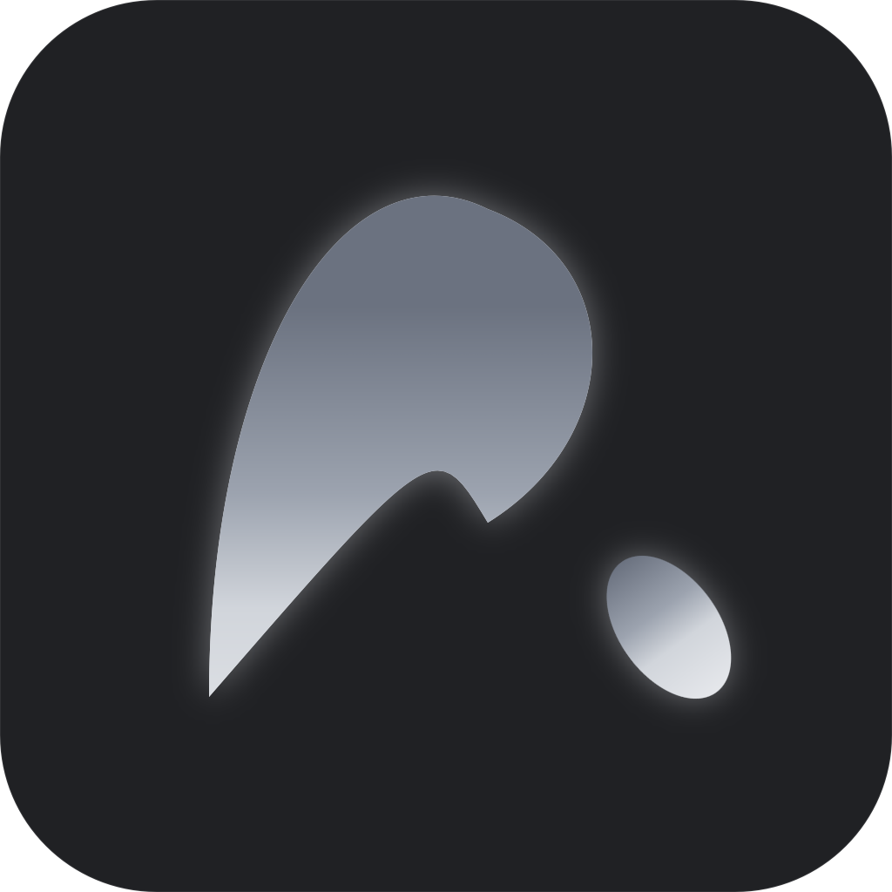

<p align="center">
  
</p>

<h1 align="center">Anti-Power</h1>

<p align="center">
  <a href="https://github.com/mikessslxxx/anti-power/releases"></a>
  
  
</p>

<p align="center">
  中文 | <a href="README_EN.md">English</a>
</p>

> 查看并清理 **Antigravity App** 和 **Antigravity CLI** (`agy`) 的本地会话.

## 功能

- 列出 Antigravity App (`~/.gemini/antigravity`) 和 Antigravity CLI (`~/.gemini/antigravity-cli`) 的会话, 也识别 CC Switch 的 `~/.cc-switch/agy/<profile>/antigravity-cli`
- 按标题, 项目或会话 ID 搜索, 按来源筛选并查看消息
- 单条或批量删除, 逐条显示结果
- 标出只剩索引的残留记录 (其他工具删掉会话文件后留下的), 可照常删除

已在 macOS 上用 Antigravity App 2.33.0 和 Antigravity CLI 1.5.12 核对. Windows 和 Linux 安装包尚未实测. 不支持 Antigravity IDE (`~/.gemini/antigravity-ide`).

## 清理范围

按来源和会话 ID 精确清理, 删除后 CC Switch 等工具刷新也不会再列出:

| 位置 | 内容 |
|------|------|
| `conversations/<id>.db` 及 `-wal`, `-shm`, `-journal`, `<id>.pb` | 会话正文 |
| `brain/<id>/` | 日志和产物 |
| `annotations/<id>.pbtxt`, `presence/<id>.lock` | 注解和占用锁 |
| `conversation_summaries.db` | 摘要, 全文索引, 父子关系 |
| `agyhub_summaries_proto.pb`, `jetbox_summaries_proto.pb` | 摘要索引 |
| `cache/last_conversations.json`, `cache/conversation_metadata.json` | 最近会话和摘要缓存 |
| `history.jsonl` | Antigravity CLI 输入历史中属于该会话的条目 |

- 子代理会话随所属会话一起删除, `/fork` 出的会话独立保留.
- 同一 ID 可能同时出现在 Antigravity App 和 Antigravity CLI 中, 两边分别显示; 若要一并清除, 需分别勾选.
- 不清理运行日志 (`log/`), 插件数据 (`sidecar_data/`) 和 Antigravity App 的窗口布局状态, 它们由各自应用管理. Usage Monitor 的缓存可能保留会话标题.
- 清理后会压缩 `conversation_summaries.db`, 库内不留已删记录的片段; 若此时有其他工具正在读取该库, 压缩会被跳过, 片段会留到下次清理. 被删除的文件本身不做磁盘级擦除.

删除前须退出 Antigravity App 和 Antigravity CLI; Antigravity IDE 运行时同样会拒绝清理. 删除无法撤销.

如果清理中途退出, 关闭上述客户端后重新打开 Anti-Power 或刷新列表: 已提交的清理会继续收尾, 尚未提交的清理会还原; 无法恢复时列表上方会给出提示.

## 用量和额度

推荐直接使用 [antigravity-usage-monitor](https://github.com/yuhuan-dev/antigravity-usage-monitor), 它以 Antigravity 插件的形式安装:

```bash
git clone https://github.com/yuhuan-dev/antigravity-usage-monitor.git ~/.gemini/config/plugins/usage-monitor
```

然后在 Antigravity App 的 **Customizations → Installed** 中启用 `usage-monitor`.

## 安装和运行

在 [Releases](https://github.com/mikessslxxx/anti-power/releases) 下载对应平台的安装包:

- **Windows**: `anti-power-windows.exe`
- **macOS (Universal)**: `anti-power-macos-universal.dmg` (未签名, 首次打开若提示 "已损坏", 运行 `xattr -cr /Applications/Anti-Power.app`)
- **Linux**: `anti-power-linux.AppImage`

从源码运行需要 Node.js 22.12+ 和 Rust 1.95+:

```bash
cd patcher
npm install
npm run tauri:dev
```

## 旧版补丁

Google Antigravity 已内置 LaTeX 和 Mermaid 渲染, 补丁功能已移除. [v4.0.0](https://github.com/mikessslxxx/anti-power/releases/tag/v4.0.0) 是最后一个包含补丁的版本, 支持到 Antigravity IDE v2.0.6.

## 文档

- 更新日志: [CHANGELOG.md](CHANGELOG.md)
- 发布指南: [release-guide.md](docs/guides/release-guide.md)

## 贡献

欢迎提交 Issue 和 Pull Request.

## 致谢

- [@daoif](https://github.com/daoif) (原作者)
- [@syanle](https://github.com/syanle)
- [@Sophomoresty](https://github.com/Sophomoresty)
- [@Wusir7355608](https://github.com/Wusir7355608)
- [@aiaiads](https://github.com/aiaiads)

## 许可证

MIT License
